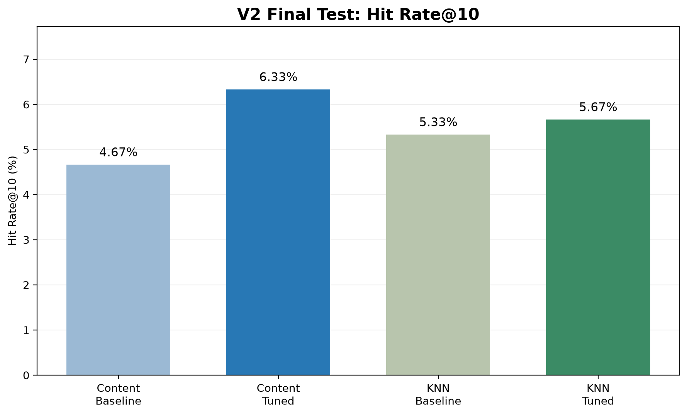
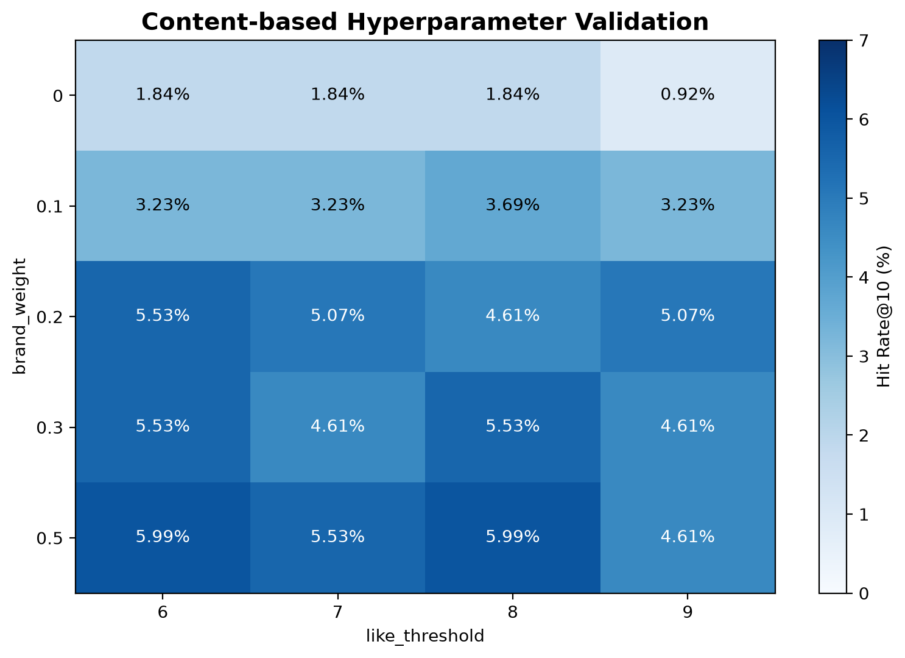
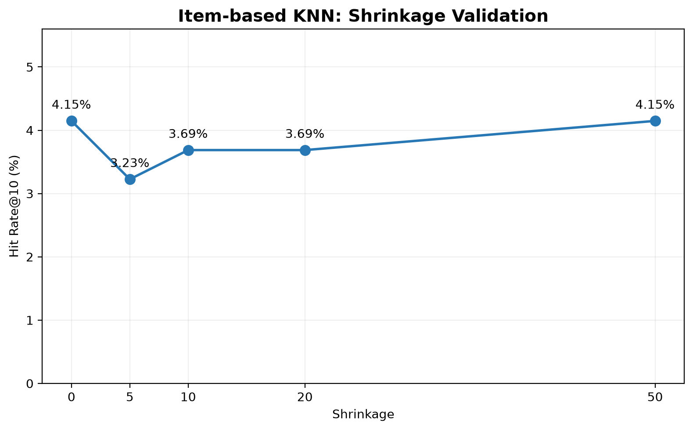

# Perfume Recommendation System

사용자의 향수 선호 이력과 향수의 특성 정보를 활용하여 개인 맞춤형 향수를 추천하는 머신러닝 팀 프로젝트입니다.

Content-based Filtering과 Item-based Collaborative Filtering을 구현하고, 동일한 추천 후보 및 테스트 조건에서 성능을 비교하였습니다.

## 1. 프로젝트 개요

### 프로젝트 목표

- 향수의 향료 및 어코드 정보를 이용한 콘텐츠 기반 추천
- 사용자별 향수 평점 이력을 이용한 협업 필터링
- 서로 다른 출처의 향수 데이터 매핑
- 추천 모델의 Top-10 성능 비교 및 하이퍼파라미터 최적화
- 추천 결과를 확인할 수 있는 GUI 제공

## 2. 사용 데이터셋

| 데이터셋 | 활용 목적 |
|---|---|
| Fragrantica | 향수 이름, 브랜드, 노트, 어코드 등 콘텐츠 특징 |
| Atrafshan | 사용자별 향수 평점 및 향수 메타데이터 |

V2 평가 데이터 기준:

- Fragrantica 전체 향수: 140,232개
- 콘텐츠 기반 모델 사용 가능 향수: 137,677개
- Atrafshan 사용자 평점: 5,565건
- 두 모델의 공통 추천 후보: 738개 향수

두 데이터셋의 향수 ID가 다르기 때문에 브랜드와 향수 이름을 기반으로 매핑하였으며, 평가에는 일대일로 연결된 `matched_exact` 후보를 사용하였습니다.

원본 대용량 데이터와 일부 전처리 데이터는 Git 저장소에서 제외하였습니다.

## 3. 추천 모델

### 3.1 Content-based Filtering

향수의 노트 및 어코드 정보를 TF-IDF 특징 벡터로 변환하고, 코사인 유사도를 이용하여 추천합니다.

사용자의 기존 선호 평점으로 프로필을 구성하여 추천 후보의 순위를 계산합니다.

- Baseline: `brand_weight=0.2`, `like_threshold=7`
- Tuned: `brand_weight=0.5`, `like_threshold=6`

### 3.2 Item-based Collaborative Filtering

사용자–향수 평점 이력을 이용하여 아이템 간 유사성을 계산하고, Item-based KNN 방식으로 추천합니다.

- 공통 설정: `k=20`, `min_common_users=2`, `min_neighbors=1`
- Baseline: `shrinkage=10`
- Tuned: `shrinkage=0`

학습 데이터에 없는 향수는 KNN 추천 대상에서 제외합니다.

## 4. 평가 방법

### 4.1 데이터 분리

사용자별 Leave-One-Out 방식으로 테스트 데이터를 구성하였습니다.

기존 학습 데이터에서 별도의 검증 데이터를 분리하여 하이퍼파라미터를 탐색하였습니다.

- 테스트 분리 시드: 42
- 검증 분리 시드: 123
- 테스트 대상 사용자: 383명
- 관련 정답 보유 사용자: 315명
- 공통 후보에 관련 정답이 포함된 주 평가 사용자: 300명
- 하이퍼파라미터 검증 관련 사용자: 217명

사용자–향수 쌍 기준으로 학습 데이터와 검증·테스트 데이터의 중복 여부를 확인하였습니다.

### 4.2 평가 지표

- 추천 개수: Top-10
- 관련 정답: 향수 평점 7점 이상
- Hit Rate@10
- Precision@10
- Recall@10
- Coverage

사용자별로 하나의 테스트 평점을 분리했으므로, 관련 정답 보유 사용자에 대한 Hit Rate@10과 Recall@10은 동일하게 계산됩니다.

### 4.3 하이퍼파라미터 탐색

| 모델 | 탐색 대상 | 조합 수 |
|---|---|---:|
| Content-based | `brand_weight` × `like_threshold` | 20 |
| Item-based KNN | `shrinkage` | 5 |
| **합계** | | **25** |

검증 데이터에서 선정한 설정으로 모델을 다시 학습하고, 최종 테스트 데이터에서 Baseline과 Tuned 모델을 비교하였습니다.

## 5. V2 최종 성능 비교

공통 추천 후보에 관련 정답이 포함된 사용자 300명을 대상으로 평가하였습니다.

| 모델 | Hit Rate@10 | Precision@10 | Recall@10 | 성공 건수 |
|---|---:|---:|---:|---:|
| Content-based Baseline | 0.0467 | 0.0047 | 0.0467 | 14 |
| **Content-based Tuned** | **0.0633** | **0.0063** | **0.0633** | **19** |
| Item-based KNN Baseline | 0.0533 | 0.0053 | 0.0533 | 16 |
| Item-based KNN Tuned | 0.0567 | 0.0057 | 0.0567 | 17 |

### 결과 분석

- Content-based: Baseline 대비 Hit Rate@10 약 **1.67%p 개선**
- Item-based KNN: Baseline 대비 약 **0.33%p 개선**
- 최종 테스트에서 Content-based Tuned 모델이 가장 높은 Hit Rate@10 기록
- 데이터 희소성 및 후보 매핑 범위로 인해 추천 성공률에 한계 존재
- 단일 데이터 분할에서 관측한 개선이므로 통계적 유의성을 단정하지 않음

관련 정답을 보유한 전체 사용자 315명 기준으로도 Content-based Tuned 모델이 Hit Rate@10 0.0603으로 가장 높은 결과를 기록하였습니다.

상세 결과는 [V1/V2 평가 문서](evaluation/EVALUATION.md)를 참고하세요.

### 성능 시각화







## 6. 프로젝트 구조

```text
perfume-recommender/
├── README.md
├── README_GUI.md
├── requirements.txt
├── requirements-lock.txt
├── perfume_recommendation.ipynb
├── run_recommender_gui.ipynb
├── preprocessing/
│   ├── preprocess_perfume.ipynb
│   └── preprocessing.md
├── evaluation/
│   ├── evaluate.ipynb
│   ├── evaluate_v2.ipynb
│   ├── EVALUATION.md
│   ├── figures/
│   └── results/
└── data_v2/                  # 로컬 데이터, Git 제외
```

`perfume_recommendation.ipynb`는 모델 구현 담당자의 최종본이 필요하며, `evaluation/figures/`는 시각화 코드 실행 후 생성됩니다.

## 7. 실행 방법

### 7.1 환경 준비

```powershell
python -m venv .venv
.\.venv\Scripts\Activate.ps1
python -m pip install -r requirements.txt
```

### 7.2 데이터 준비

V2 평가에는 프로젝트 루트의 `data_v2/` 폴더에 다음 파일이 필요합니다.

- `perfumes_content.csv`
- `user_ratings.csv`
- `user_ratings_linked.csv`
- `perfume_mapping.csv`
- `atrafshan_perfumes.csv`

원본 데이터 및 V2 전처리 결과는 팀 내부 공유 경로를 통해 준비해야 합니다.

### 7.3 평가 실행

1. `perfume_recommendation.ipynb` 모델 구현 파일 준비
2. VS Code 또는 Jupyter에서 `evaluation/evaluate_v2.ipynb` 열기
3. 프로젝트 가상환경 커널 선택
4. 셀을 순서대로 실행
5. `evaluation/results/`의 CSV 및 `evaluation/figures/`의 그래프 확인

GUI 사용 방법은 [README_GUI.md](README_GUI.md)를 참고하세요.

## 8. V1 평가 기록

V1에서는 258명을 대상으로 다음 결과를 얻었습니다.

| 모델 | Hit Rate@10 |
|---|---:|
| Content-based | 0.0620 |
| Item-based KNN | 0.0581 |

V1과 V2는 데이터 규모, 매핑 및 평가 조건이 다르므로 성능 수치를 직접 비교하지 않습니다.

## 9. 한계 및 향후 개선 방향

- 사용자–향수 평점 행렬의 희소성
- 서로 다른 데이터셋 간 향수 ID 매핑의 불확실성
- 공통 후보 집합에 한정된 평가
- KNN의 미학습 아이템 추천 불가능 문제
- 단일 데이터 분할에 따른 평가 결과의 변동 가능성
- 실제 사용자 평가를 통한 추천 품질 검증 필요성

향후에는 데이터 매핑 개선, 사용자 평가 데이터 확충 및 추가 평가 분할을 통한 성능 검증을 고려할 수 있습니다.